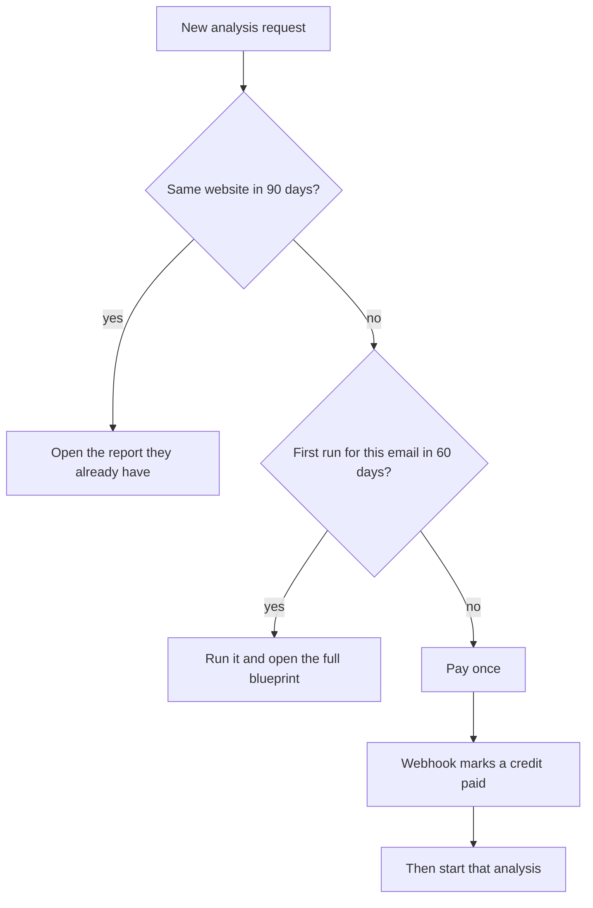

# Is this ready to charge?

Stripe is not in the app. There is no `Payment` table. Admin Payments says billing is off. That part is not ready, and it is a small add: Checkout, a webhook, and one table.

The place to charge is already in the code. [web/lib/analysis/constants.ts](web/lib/analysis/constants.ts) allows **1 free analysis per email every 60 days**. [web/lib/analysis/submit.ts](web/lib/analysis/submit.ts) then says “Free analysis limit reached” and stops. It does not offer a way to pay. A lead marked `WON` or `PROPOSAL_SENT` skips that stop. That is a sales flag, not a card payment.

What a person gets today:

- The first finished analysis is fully open: report, PDF, and consultant. Nothing is locked.
- A second website in those 60 days does not run.
- The same website inside 90 days does not run again. [web/lib/analysis/dedup.ts](web/lib/analysis/dedup.ts) returns the report we already have.
- A visitor with no email is limited only by a browser token, so a new visit can get another free run. That hole has to close before a second-run charge means anything.
- The homepage still says the preview is free and **$5 unlocks the blueprint**. The code does not do that. Login already opens the full blueprint.

So the system is ready for a pay step at the moment the second run is refused. It is not ready for a switch that hides the first report.

## Ways to charge

**1. First blueprint free and full. Pay before the next one.** This is the one that matches the code and the idea you described. The first report stays downloadable. The next new website shows a pay button instead of “try again in 60 days.” We start the worker only after Stripe says paid, so we do not pay the API cost for a run they abandon. The same website inside 90 days is not a new charge.

**2. Free preview, then pay to see each full blueprint.** This matches the homepage sentence. The preview screen exists, but the full report is not actually hidden. We would still pay for every run even when they never buy. This fights what the product does today.

**3. Pay before the first run.** We never spend API money until they pay. It also throws away the free first look, and the site currently promises that look.

**4. First one free, then a monthly plan for more runs.** [web/lib/analysis/rate-limit.ts](web/lib/analysis/rate-limit.ts) already has a “paying client skips the limit” check. Turning that into a subscription is a later build, not this one.

**5. Show the full report free, charge only for the PDF.** Weak. They can already read the plan on screen.

Growth ($999), Scale ($1,999), and “ask us to build this” stay sales conversations. They are not this checkout.

## Locked choice

Option 1. The first blueprint for an email stays free, including the PDF and the consultant. A different website after that asks for a one-time payment, and the analysis starts only after Stripe confirms it. Options 2 through 5 are not this build.

## What we build

- `Payment` is a credit for one new run: email, amount from Stripe, status, checkout id, customer id. `StripeEvent` stops a repeated webhook from granting two runs.
- Checkout opens only when [web/lib/analysis/submit.ts](web/lib/analysis/submit.ts) would have returned `rate_limited`. Success does not enqueue by itself. The webhook marks the credit paid, then the queued analysis is allowed to start.
- Count free runs by email. A second attempt without an email asks for the email instead of starting a new guest run.
- Do not charge to reopen a website we analyzed in the last 90 days.
- Leads already marked `WON` or `PROPOSAL_SENT` keep skipping the limit, as they do now.
- Homepage and FAQ change from “$5 unlocks the blueprint” to “the first blueprint is free; the next one is paid.”
- Admin Payments lists these credits and returns to the nav. Subscriptions stay off.
- The live amount is a Stripe Price, not a number buried in the page. $5 was written for unlocking a report we already made. A second run is a new pipeline. Check a few real `ToolUsageLog` totals before choosing that Price.

## Test gate

Stripe test mode only. A second event does not grant two runs. A second email cannot start a free run. A new browser token cannot either. The same website reopens without a charge. A refund removes the unused credit and does not delete the first free blueprint.
